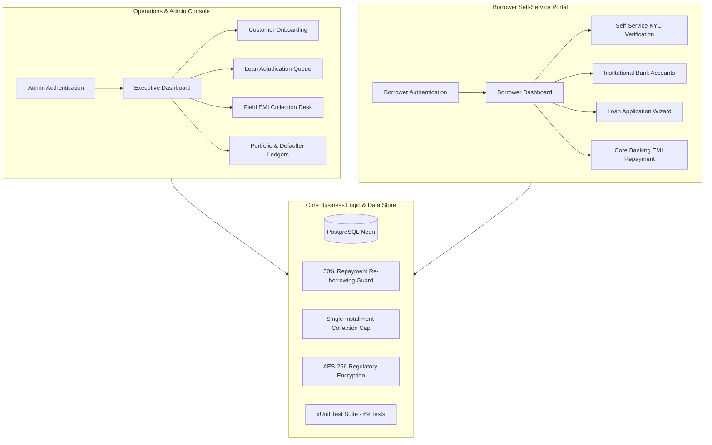

# 🛡️ FinGuard — Institutional Microfinance Management & Core Banking Portal

[](https://dotnet.microsoft.com/)
[](https://learn.microsoft.com/en-us/dotnet/csharp/)
[](https://learn.microsoft.com/en-us/ef/core/)
[](https://neon.tech/)
[](#security-architecture)
[](#automated-testing)

FinGuard is a comprehensive, enterprise-grade Microfinance Management and Digital Core Banking System built on **ASP.NET Core (.NET 10)**. Designed for microfinance institutions (MFIs), non-banking financial companies (NBFCs), field agents, and borrowers, FinGuard streamlines the end-to-end loan lifecycle—from customer onboarding and self-service KYC identity verification to risk adjudication, single-installment field collections, and automated repayment tracking.

---

## 📌 Architectural Overview

FinGuard is architected as a secure dual-portal application with strict privilege separation:

1. **Operations & Admin Console (`/Home`, `/Customer`, `/Loan`, `/Repayment`)**:
   - Dedicated workspace for institutional credit officers, branch managers, and field agents.
   - Comprehensive borrower onboarding, loan portfolio analytics, credit scoring, application adjudication queue, and single-month EMI collection desk with instant voucher generation.

2. **Borrower Self-Service Portal (`/Portal`, `/BorrowerAuth`)**:
   - Independent borrower portal isolated under a dedicated authentication cookie scheme (`BorrowerCookies`).
   - Enables registered borrowers to self-verify identity documents (Aadhaar & PAN), link institutional bank accounts, submit loan applications up to ₹10,00,000, monitor real-time approval status, and perform EMI payments with exact settlement caps.



---

## ✨ Key Features & Business Rules

### 1. Unified Customer Model & Authentication Isolation
- Customer records are unified in the primary `Customers` entity, eliminating duplicate schemas.
- Borrowers authenticate using their registered mobile phone number and a BCrypt-hashed password.
- Multi-cookie isolation ensures administrative sessions (`AdminCookies`) and borrower sessions (`BorrowerCookies`) remain strictly segregated without session collision.

### 2. Self-Sovereign Identity & KYC Verification
- **Self-Service Verification**: Identity verification is performed exclusively by the borrower from their portal, ensuring data privacy and regulatory compliance.
- **Aadhaar Verification**: Validates 12-digit UIDAI numbers with official Verhoeff checksum algorithm and OTP challenge.
- **PAN Card Verification**: Validates 10-character alphanumeric formats (`[A-Z]{5}[0-9]{4}[A-Z]{1}`) with OTP challenge.
- **Cryptographic Security**: Sensitive identification data is encrypted at rest using AES-256 via `EncryptionHelper`. Only securely masked representations (`•••• •••• 1234` and `ABC•••••1D`) are rendered in user interfaces.

### 3. Loan Adjudication & Lifecycle Management
- **Configurable Limits**: Loan amounts up to ₹10,00,000 with tenures up to 10 years (120 months) and transparent annual interest rates.
- **Institutional Adjudication Queue**: Loan officers review pending requests with applicant profile details, existing exposure, and calculated credit scores.
- **Decision Auditability**: Officers can approve or reject applications. Rejections record mandatory formal remarks displayed transparently on the borrower's tracking screen.

### 4. Bank Account Management & Anti-Overleverage Safeguard
- Borrowers link verified institutional bank accounts (validated IFSC and account formatting).
- **The 50% Repayment Rule**: To prevent predatory over-indebtedness, a borrower cannot submit a new loan application using a bank account associated with an active loan until **at least 50% of the loan amount has been repaid**, or the loan is fully settled. Applications using other verified accounts remain permitted.

### 5. Single-Installment Field Collection & Receipts
- **Field Agent Cap**: When collecting EMIs in the field, administrators and recovery agents can collect **a maximum of one monthly installment per transaction**.
- **Payment Voucher Generation**: Each collection immediately generates a printable, timestamped collection receipt with a unique transaction reference, agent identification, and updated outstanding balance.

### 6. Borrower EMI Settlement Gateway
- Direct core banking repayment flow built into the borrower portal.
- **Exact Settlement Guard**: Borrowers cannot pay more than their remaining outstanding loan balance.
- **Repayment History & Digital Receipts**: Complete historical ledger accessible from both borrower and administrator interfaces.

---

## 🧰 Technology Stack

| Layer | Technologies |
|---|---|
| **Framework** | ASP.NET Core (.NET 10.0), C# 12 |
| **Data Access & ORM** | Entity Framework Core 8.0, Npgsql PostgreSQL Provider |
| **Database** | Neon Serverless PostgreSQL |
| **Authentication & Security** | ASP.NET Core Dual-Cookie Authentication, BCrypt.Net-Next, AES-256 Encryption |
| **Frontend** | Razor Views (MVC), Vanilla CSS Design System, Responsive Glassmorphism, Vanilla JavaScript |
| **Testing** | xUnit, Microsoft.EntityFrameworkCore.InMemory (69 Automated Unit & Integration Tests) |
| **Version Control** | Git & GitHub |

---

## 🏗️ Project Structure

```text
FinGuard/
├── Controllers/
│   ├── AuthController.cs               # Administrative authentication & password recovery
│   ├── BorrowerAuthController.cs       # Borrower registration, login, and credential management
│   ├── CustomerController.cs           # Customer onboarding, profile directory, and credit status
│   ├── HomeController.cs               # Administrative operational KPI dashboard
│   ├── LoanController.cs               # Loan issuance and adjudication review queue
│   ├── PortalController.cs             # Borrower self-service workspace & repayment gateway
│   ├── ProfileController.cs            # Administrator profile settings
│   └── RepaymentController.cs          # Field EMI collection desk, vouchers, and audit ledgers
├── Data/
│   └── ApplicationDbContext.cs         # EF Core DbContext with relational configurations
├── Migrations/                         # PostgreSQL schema evolution migrations
├── Models/
│   ├── AdminUser.cs                    # Internal staff entity
│   ├── BankAccount.cs                  # Borrower institutional bank accounts
│   ├── BorrowerViewModels.cs           # Portal view models & payment requests
│   ├── Customer.cs                     # Unified customer entity with borrower credentials
│   ├── KycVerificationRecord.cs        # Comprehensive KYC state & verification metadata
│   ├── KycViewModels.cs                # Document verification requests & responses
│   ├── Loan.cs                         # Loan contracts, interest rates, tenures, and status
│   ├── LoanDisbursement.cs             # Fund disbursement tracking records
│   └── Repayment.cs                    # Repayment transactions with banking references
├── Services/
│   ├── BankAccountService.cs           # Bank account validation and 50% repayment checks
│   ├── EmailService.cs                 # Automated notification service
│   ├── Kyc/                            # Institutional KYC verification engines
│   └── SimulatedDisbursementService.cs # Automated fund disbursement engine
├── Utilities/
│   ├── EncryptionHelper.cs             # AES-256 symmetric encryption for sensitive PII
│   └── KycFormatHelper.cs              # Verhoeff algorithm and PAN formatting logic
├── Views/                              # Razor MVC views organized by operational domain
├── wwwroot/                            # CSS stylesheets, JavaScript modules, and vendor libraries
├── FinGuard.Tests/                     # Comprehensive xUnit test suite (69 test cases)
├── Program.cs                          # Application entry point & service container configuration
└── appsettings.json                    # Configuration file for connection strings and logging
```

---

## ⚙️ Getting Started

### Prerequisites

Ensure you have the following installed on your development workstation:
- [.NET 10.0 SDK](https://dotnet.microsoft.com/download/dotnet/10.0) (or compatible .NET 8+ runtime)
- A running [PostgreSQL](https://www.postgresql.org/) database or a free [Neon](https://neon.tech/) serverless PostgreSQL instance
- [Git](https://git-scm.com/)

### Installation & Run

1. **Clone the repository:**
   ```bash
   git clone https://github.com/kumarhimanshu3132/FinGuard.git
   cd FinGuard
   ```

2. **Restore dependencies:**
   ```bash
   dotnet restore
   ```

3. **Configure Database Connection:**
   Update `DefaultConnection` in `appsettings.json` with your PostgreSQL connection string:
   ```json
   "ConnectionStrings": {
     "DefaultConnection": "Host=your-postgres-host;Database=finguard_db;Username=your-user;Password=your-password;SSL Mode=Require;Trust Server Certificate=true"
   }
   ```

4. **Apply Database Migrations:**
   ```bash
   dotnet ef database update
   ```

5. **Run the Application:**
   ```bash
   dotnet run
   ```
   Navigate to `http://localhost:5042` (or the URL displayed in your console) to access FinGuard.

---

## 🧪 Automated Testing

FinGuard includes a comprehensive test suite of **69 unit and integration tests** verifying authentication isolation, Verhoeff checksum calculations, KYC OTP workflows, single-installment EMI limits, exact settlement validation, and the 50% bank account repayment guard:

```bash
dotnet test
```

**Test Suite Coverage Summary:**
- `BorrowerAuthIsolationTests`: Multi-cookie scheme isolation and credential security.
- `KycFormatAndChecksumTests`: Verhoeff algorithm validation and PAN pattern matching.
- `KycOtpVerificationTests`: Aadhaar/PAN challenge generation, attempt lockouts, and verification.
- `KycOverallStatusAndWorkflowTests`: End-to-end KYC progression rules and constraints.
- `KycSecurityAndAccessTests`: PII masking, authorization guards, and encryption at rest.
- `RepaymentAndOnboardingWorkflowTests`: Single-installment EMI collection caps, balance settlement rules, and 50% re-borrowing guards.

---

## 🔐 Security Architecture

- **Zero Hinglish / Formal Localization**: The entire platform, views, error messages, and documentation adhere strictly to professional English standards.
- **Data Protection**: Sensitive personally identifiable information (Aadhaar, PAN) is encrypted using AES-256 before persisting to PostgreSQL.
- **Access Control**: Role-based access ensures administrative operations are strictly guarded, while borrowers can only view and manage their own records.
- **CSRF & Injection Defenses**: Every POST operation is secured with anti-forgery tokens (`[ValidateAntiForgeryToken]`), and all database interactions utilize parameterized LINQ queries via Entity Framework Core.

---

## 👥 Project Contributors

This application is developed collaboratively as an advanced microfinance engineering project:

- **Himanshu Kumar** — Project Lead & Backend Architect ([@kumarhimanshu3132](https://github.com/kumarhimanshu3132))
- **Sudhanshu Rounak** — Full-Stack Developer & UI Architecture ([@Sudhanshu-Rounak](https://github.com/Sudhanshu-Rounak))
- **Aditya Kumar** — Full-Stack Developer & Security Operations ([@adityakumar-23](https://github.com/adityakumar-23))

---

## 📄 License

This project is developed for educational and academic demonstration purposes. All rights reserved.